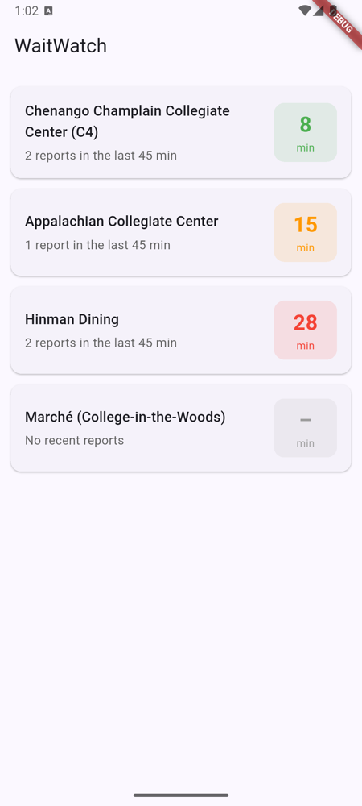
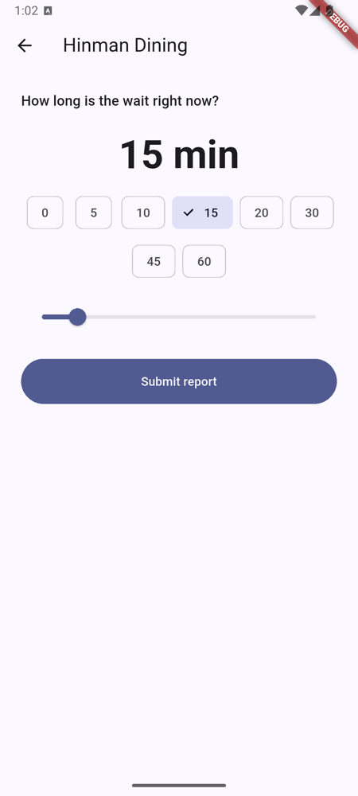
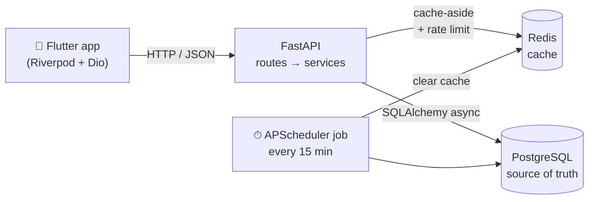
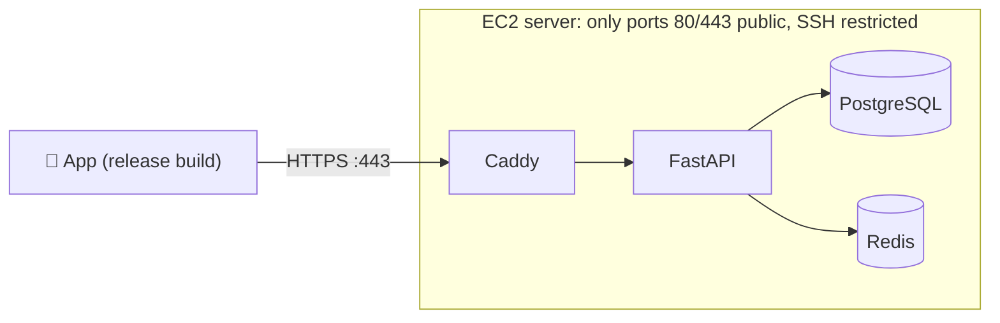

# WaitWatch

**Live, crowdsourced wait times for Binghamton University dining halls.**

Students standing in line tap one button to report how long the wait is. Everyone else sees a live average for every hall before they walk over. No sign-up: each phone gets an anonymous ID.

<p align="center">
  
  &nbsp;&nbsp;&nbsp;
  
</p>

## Features

- **Live averages** for 4 dining halls (C4, Appalachian, Hinman, Marché), colour-coded green / amber / red
- **One-tap reporting** with quick picks (0–60 min) or a slider (0–120 min)
- **Always fresh:** only reports from the last 45 minutes count
- **Spam-resistant:** one report per device, per hall, every 10 minutes
- **Fast:** results are cached in Redis, so most requests never touch the database
- **Resilient:** if Redis goes down, the app keeps working straight from PostgreSQL

## Architecture



| Request | What happens |
|---|---|
| `GET /venues` | Read the cached list from Redis. On a miss, compute each hall's average from fresh reports in Postgres and cache it for 5 minutes. |
| `POST /venues/{id}/reports` | Check the rate limit (an atomic Redis `SET NX EX`), save the report to Postgres, then delete the cached list so the next read is up to date. |
| Background job | Every 15 minutes: mark reports older than 45 minutes as stale (never deleted), save a snapshot of each hall's average, clear the cache. |

### Design highlights
- **PostgreSQL is the source of truth, Redis is only an optimisation.** Every Redis call has a 1-second timeout and falls back to Postgres on failure.
- **Thin routes, logic in a service layer.** The background job reuses the same averaging code as the API.
- **Rules enforced twice:** Pydantic validates input (clear 422 errors), and database constraints (`CHECK 0–120`, `UNIQUE`, foreign keys) are the last line of defence.
- **Atomic rate limiting:** ten simultaneous requests from one device result in exactly one saved report (covered by a test).
- **Schema changes through Alembic migrations**, which the test suite also uses to build its database.

## Tech stack

| Layer | Tools |
|---|---|
| Mobile app | Flutter 3.29, Dart 3.7, Riverpod 3, Dio, SharedPreferences |
| API | Python 3.12, FastAPI, Pydantic, SQLAlchemy 2 (async), asyncpg |
| Data | PostgreSQL 16, Redis 7, Alembic |
| Background jobs | APScheduler (in-process) |
| Tooling | Docker Compose, pytest, flutter_test |

## Getting started

**Prerequisites:** Docker Desktop, and Flutter with an Android emulator for the app.

### 1. Backend
```bash
git clone https://github.com/omwaikar1/waitwatch.git
cd waitwatch
cp backend/.env.example backend/.env

docker compose up -d --build                           # Postgres, Redis, API
docker compose exec backend alembic upgrade head       # create tables
docker compose exec backend python -m app.seed         # add the dining halls

curl localhost:8000/venues
```
Interactive API docs: <http://localhost:8000/docs>

### 2. Mobile app
```bash
cd frontend
flutter pub get
flutter emulators --launch <emulator_id>   # list them with: flutter emulators
flutter run
```
The app talks to `http://10.0.2.2:8000`, which is the Android emulator's address for your computer's `localhost`. To use a different server:
```bash
flutter run --dart-define=API_BASE_URL=https://your-server
```

## API

| Method | Path | Body | Responses |
|---|---|---|---|
| `GET` | `/health` | | `200 {"status": "ok"}` |
| `GET` | `/venues` | | `200` list of `{id, name, lat, lng, avg_wait_minutes, report_count}` |
| `POST` | `/venues/{id}/reports` | `{"device_id": "<uuid>", "wait_minutes": 0–120}` | `201` created · `404` unknown hall · `422` invalid input · `429` too soon (with `Retry-After`) |

## Tests

```bash
docker compose exec backend pytest    # 31 tests: services, rate limiting, background job, HTTP
cd frontend && flutter test           # 17 tests: models, API client, both screens
```
Backend tests run against a separate `waitwatch_test` database and Redis database 15, so they never touch development data.

## Deployment

The API runs on a single AWS EC2 instance (`t4g.small`, Ubuntu 24.04) with Docker Compose. [Caddy](https://caddyserver.com) sits in front and gets a free Let's Encrypt HTTPS certificate automatically.



| File | Purpose |
|---|---|
| `deploy/docker-compose.prod.yml` | Production stack. Only Caddy publishes ports; the database password comes from the server's own `deploy/.env` |
| `deploy/Caddyfile` | HTTPS + reverse proxy to the API |
| `deploy/cloud-init.sh` | First-boot setup: Docker, swap, automatic security updates |
| `deploy/deploy.sh <ip>` | Copies the code, then runs `server-up.sh` on the server: migrate → seed → start, waiting until every container is healthy |
| `deploy/aws-teardown.sh` | Deletes every AWS resource the project created |

The hostname comes from [sslip.io](https://sslip.io), which maps `1-2-3-4.sslip.io` to the IP `1.2.3.4`, so no domain purchase is needed. Build the app against the live API with:
```bash
flutter build apk --release --dart-define=API_BASE_URL=https://<ip-with-dashes>.sslip.io
```

## Project structure

```
backend/
  app/
    config.py        settings from environment variables
    db/              async engine + sessions, Redis client
    models/          SQLAlchemy tables: Venue, WaitReport, VenueStats
    schemas/         Pydantic request/response shapes
    routes/          HTTP handlers (thin)
    services/        business logic: averages, caching, rate limiting
    jobs/            APScheduler stale-report job
    seed.py          dining halls and their coordinates
  alembic/           database migrations
  tests/             pytest suite
deploy/              production Compose file, Caddy, deploy + teardown scripts
frontend/
  lib/
    api/             ApiClient: the only code that talks HTTP
    models/          Venue
    screens/         venue list, report screen
    providers.dart   Riverpod providers
  test/              widget and unit tests
docker-compose.yml
```

## Roadmap
- [x] Deploy the API to AWS EC2 with HTTPS
- [x] Release build of the Android app pointing at the live API
- [ ] Map view of the halls
- [ ] Busy-time trends from historical snapshots
